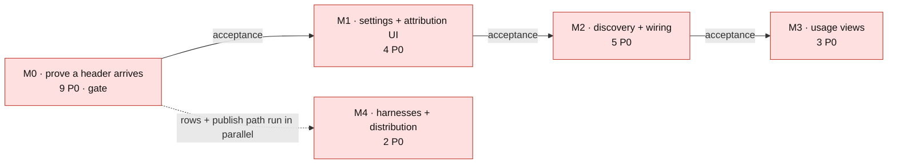
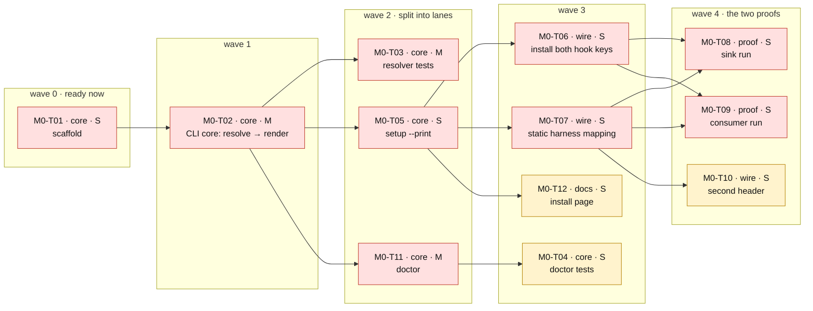
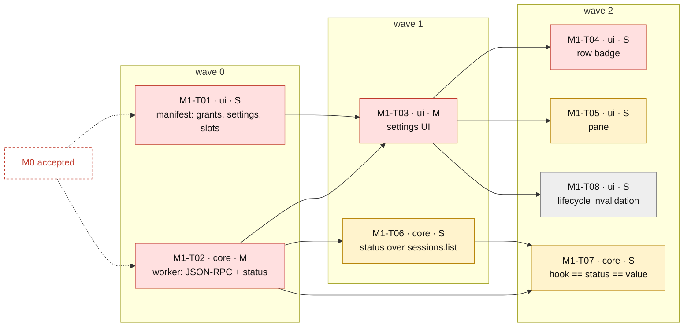
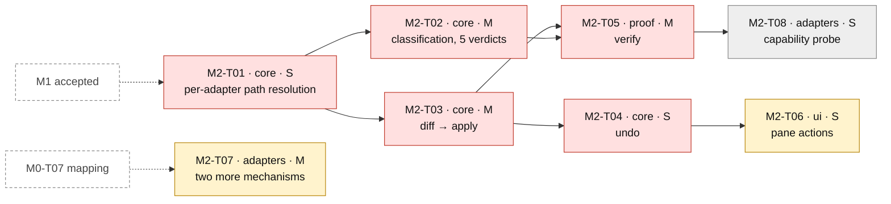
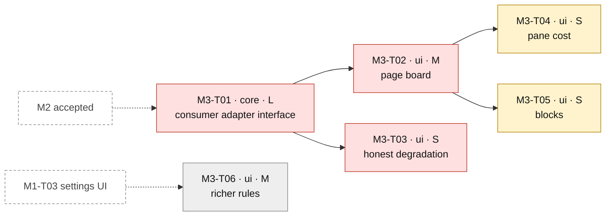
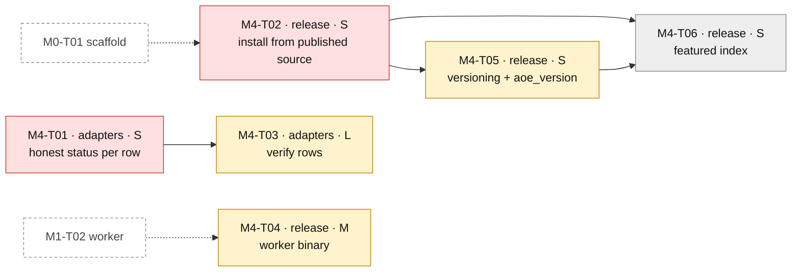
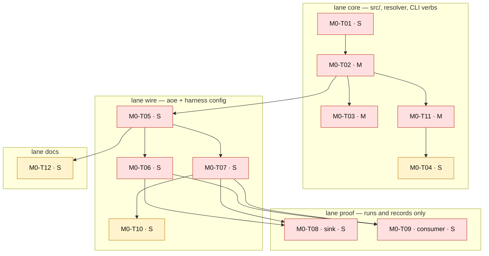
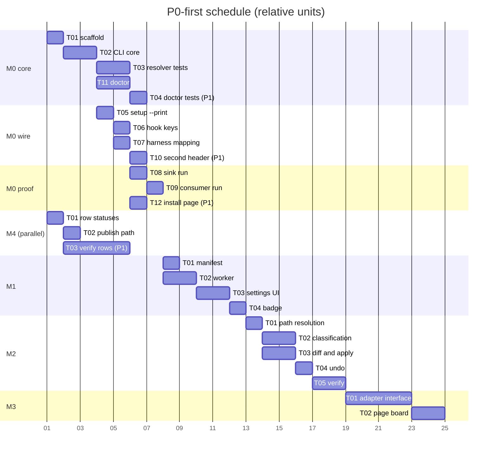

# Plan graph

Mermaid views of the plan: the ladder, one dependency graph per milestone, the M0 lane
swimlanes, and a relative-effort schedule. Source of truth is the task tables in `mN.md` and the
priority/lane rules in `README.md` — if a diagram here disagrees with them, the diagram is wrong.

**Legend**

| Mark | Meaning |
|---|---|
| `P0` red / `P1` amber / `P2` grey | Priority: P0 blocks the milestone's acceptance, P1 needed to use it for real, P2 may slip |
| node text `M0-T07 · wire · S` | Task ID, lane, size (S ≤2 h, M ≤½ day, L ≈1 day) |
| solid arrow | Hard dependency: the target task cannot start first |
| dashed arrow | Cross-milestone entry: the gate, not a task |
| `wave N` | Topological level — everything in a wave is unblocked at the same time. Same-lane tasks inside one wave are sequential in practice. |

## 1. The ladder

Priority never reorders the ladder. It only orders work inside one box — and it lets the M4 lane
start from M0 while M1–M3 march in sequence.

## 2. M0 — prove a header arrives

**Critical path:** `T01 → T02 → T05 → T06/T07 → T08/T09`. Everything else hangs off `T02` or off
the host preconditions. `T08` and `T09` are two independent proofs of the same wiring — the sink
(mechanism) and the real consumer (delivery) — and must not be collapsed into one task.

## 3. M1 — settings and attribution UI

## 4. M2 — discovery and wiring

`T02` (does it look wired?) and `T03` (write it) both build on `T01` but touch different code, so
they can be split across two workers. `T04` is P0 even though it looks like cleanup: acceptance #2
is byte-identical `undo`, and that is the check that keeps the writer honest.

## 5. M3 — usage views

## 6. M4 — harnesses and distribution

`T01` and `T02` have no dependency on M1–M3: the table can be made honest and the install path can
be proven today, which is why M4 is the one milestone that genuinely overlaps M0.

## 7. M0 by lane — what can actually run at once

Two workers: one in `core` (T02 → T03/T11) and one in `wire` (T05 → T06/T07 → T08/T09). They meet
only at the single arrow `T02 → T05`, which is the hook line's command string — so the `wire`
worker can start as soon as `setup --print` exists, and never has to rebase onto `bin/`.

## 8. Relative-effort schedule

Units are relative effort (S = 1, M = 2, L = 4), not calendar days. The ladder is sequential; the
overlap between M0 and M4's release lane is the only cross-milestone concurrency.

## What to check in these diagrams

1. **No P0 depends on a P1.** Follow every arrow into a red node: the source must be red. (The one
   amber arrow into red — `T11 → T04` — is a P1 depending on a P0, which is the allowed direction.)
2. **Every wave-0 node has no arrow in** except a dashed milestone gate. If a task has no arrow in
   but is not in wave 0, the table's `Depends` cell is missing something.
3. **The two proofs are separate.** `T08` and `T09` share all their inputs and prove different
   things; merging them hides which leg failed.
4. **The lane crossing is a single edge.** In M0 the only `core → wire` arrow is `T02 → T05`. If a
   change adds a second one, the split has broken down and the tasks should be re-cut.
